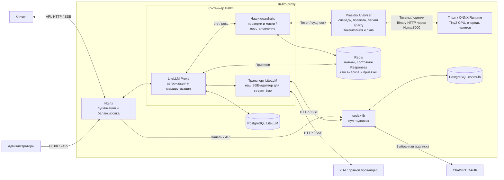
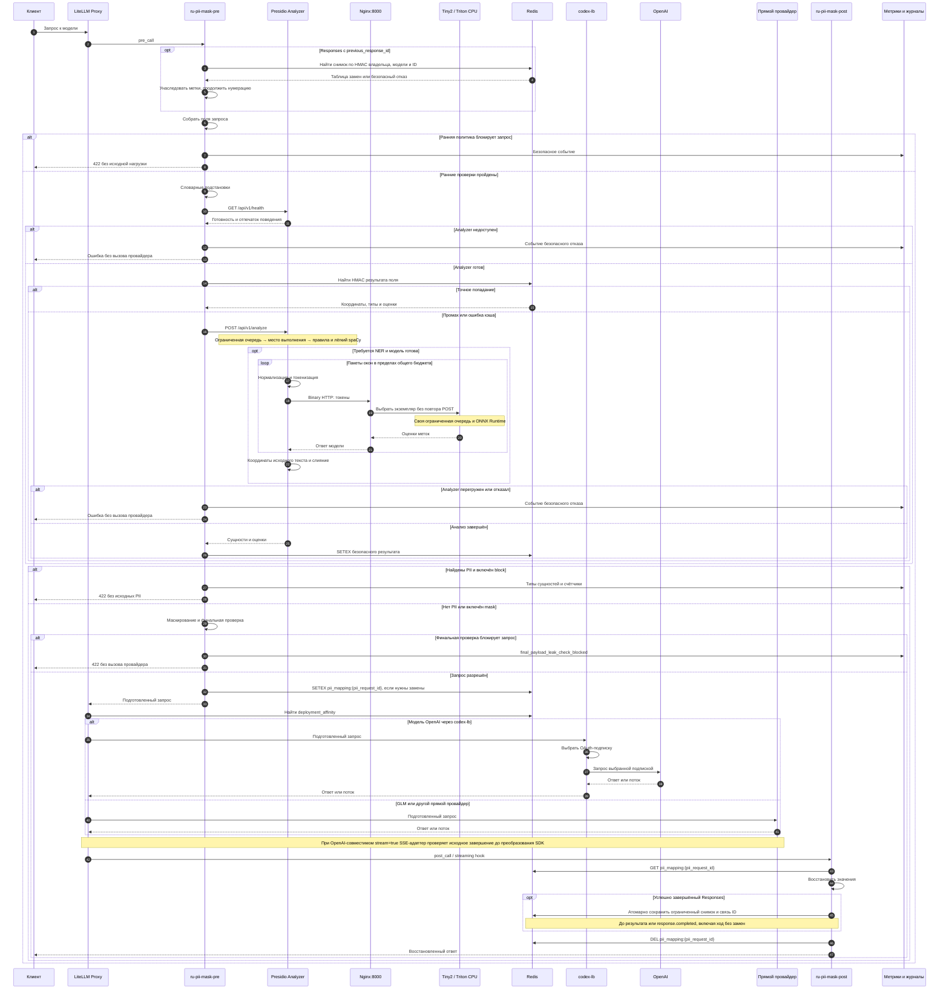

# Архитектура

Документ описывает компоненты, поток запроса и границы данных текущей реализации.
Настройки собраны в [configuration.md](configuration.md), команды проверки — в
[examples.md](examples.md), эксплуатационные действия — в
[monitoring.md](monitoring.md).

## Компоненты

| Компонент | Ответственность |
| --- | --- |
| Nginx (`nginx`) | Публикация LiteLLM и панели `codex-lb`; балансировка production; внутренний HTTP-маршрут Analyzer → Triton на `8000` |
| LiteLLM Proxy (`litellm`) | API-шлюз, проверка клиентских ключей, выбор провайдера модели, запуск защитных обработчиков |
| PII Guardrail (`litellm_guardrails/pii_guardrail.py`) | Ранние политики, маскирование, блокировка и восстановление ответа |
| SSE-адаптер (`litellm_guardrails/upstream_stream.py`) | Проверка исходного SSE и владение HTTP-ответами попыток внутри LiteLLM, без отдельного сервиса |
| Presidio Analyzer (`presidio-analyzer`) | Очередь анализа, правила Presidio, облегчённый spaCy, токенизация Tiny2, обработка окон и объединение результатов |
| Triton (`ner-triton`) | Исполнение закреплённого ONNX Tiny2 на CPU через штатный ONNX Runtime; собственные очередь и объединение пакетов |
| Redis (`redis`) | Временные таблицы замен, ограниченное состояние Responses, HMAC-кэш координат и привязка клиента к провайдеру модели |
| PostgreSQL LiteLLM (`db`) | Пользователи, ключи, бюджеты и состояние LiteLLM |
| `codex-lb` (расширенный состав) | Пул ChatGPT OAuth-подписок, квоты и выбор учётной записи по диалогу/кэшу |
| PostgreSQL `codex-lb` (`codex-lb-db`) | Зашифрованные OAuth-данные, настройки, маршрутизация и журналы `codex-lb` |

Tiny2 определяет восемь NER-классов; правила Presidio дополняют её структурными
проверками. У spaCy остаются токенизация, лемматизация и разметка предложений:
нейросетевые компоненты, в том числе `ner`, отключены. Обнаружения spaCy не
добавляют имена, организации или локации. Вычислительных весов Tiny2 в Analyzer
нет: он отправляет токены в Triton и переводит ответ в координаты исходного текста.
Платформы LiteLLM и Triton не патчатся; HTTPX-интеграция находится в нашем коде.

Переход на Tiny2/Triton принят владельцем с ограничениями:
[итоговое сравнение](research/tiny2-quality-comparison.md) содержит как улучшения,
так и пропуски и лишние маски. Выборочный фильтр `entities` требует правильного
класса, поэтому полное покрытие при поиске всех классов не доказывает его полноту.
Изменение логики анализа меняет его отпечаток и автоматически отделяет старый
кэш координат; очищать Redis вручную не требуется.

## Компонентная схема

Схема показывает функциональные компоненты. В `TOPOLOGY=production` работают
два экземпляра LiteLLM, четыре Analyzer и два Triton; тот же Nginx балансирует пулы.
Redis и PostgreSQL остаются общими, codex-lb и его база — одиночными.
Настройки и границы одно-серверной топологии: [deployment.md](deployment.md).

Схема включает Nginx, но не показывает внешний слой
завершения HTTPS, межсетевой экран и другие компоненты инфраструктуры предприятия.



Двусторонняя стрелка обозначает запрос и ответ. Метрики и безопасные журналы
собираются с каждой реплики отдельно ([мониторинг](monitoring.md)); ради
читаемости эти связи на схеме не показаны. Порядок вызовов раскрыт ниже.

## Целевая производственная топология

Текущий Docker Compose предназначен для разработки, испытаний и установки на
одном сервере. Целевая схема для 400 пользователей должна сохранить единое
управление ключами LiteLLM, но независимо масштабировать обработку запросов и
Analyzer. Реализация этой схемы относится к задаче #59.

| Слой | Целевая схема |
| --- | --- |
| Входящий трафик | Внутренний Ingress или Gateway и Service Kubernetes; испытательные балансировщики из `tests/load` не используются |
| LiteLLM | Не менее двух обслуживающих экземпляров, один процесс на Pod, общие Redis и PostgreSQL |
| Фоновые задания LiteLLM | Один отдельный экземпляр без клиентского трафика, если закреплённая версия LiteLLM поддерживает разделение ролей |
| Analyzer и Triton | Раздельные Deployment; один процесс Analyzer на Pod, один проверенный комплект модели во всех Triton; количества и ресурсы требуют сквозных измерений |
| `codex-lb` | Штатный StatefulSet/Helm с несколькими экземплярами, общей ключевой информацией и передачей состояния Responses API между владельцами сессий |
| Состояние | Отказоустойчивые Redis и PostgreSQL; базы LiteLLM и `codex-lb` имеют разные учётные данные, миграции и резервные копии |

LiteLLM, Analyzer и Triton масштабируются раздельно. Рост числа LiteLLM не
ускоряет модель. Каждый Analyzer содержит собственные spaCy, токенизатор и
HTTP-пул; ONNX и исполнения модели находятся в Triton. Избыток реплик на одном
CPU-сервере увеличивает конкуренцию за ресурсы. Прежняя
[матрица масштабирования](research/scaling-matrix.md) относится к другой модели;
локальные [измерения Tiny2](research/tiny2-capacity.md) не подтверждают ёмкость
на 400 пользователей.

Обслуживающие экземпляры LiteLLM должны получать конфигурацию из одного
источника и иметь общий Redis. Число соединений каждого процесса с PostgreSQL,
Redis и Analyzer рассчитывается с учётом максимального числа экземпляров, а не
только текущего. Версия образа LiteLLM должна быть закреплена; использование
плавающего `main-stable` в производственном Kubernetes-контуре не допускается.

Для `codex-lb` следует использовать его штатный многорепличный режим, а не
копировать односерверную схему Compose. Все экземпляры используют одну базу и
одинаковый ключ шифрования. Маршрутизация Responses API должна учитывать
владельца сессии, а завершение Pod — оставлять время на штатное осушение
соединений.

Отказы сохраняют следующие границы:

- недоступный или перегруженный Analyzer останавливает запрос до провайдера с
  повторяемым HTTP 503;
- недоступный Redis блокирует операции, для которых нельзя безопасно прочитать
  или сохранить состояние защитного слоя;
- недоступный PostgreSQL LiteLLM останавливает проверку ключей и
  административные операции; разрешение запросов без базы требует отдельного
  анализа безопасности и по умолчанию не применяется;
- отказ `codex-lb` затрагивает маршруты ChatGPT OAuth, но не прямых провайдеров;
- плановое обновление не должно одновременно выводить из работы все экземпляры
  одного прикладного компонента.

Текущие ресурсы Compose и пределы их проверки приведены в
[руководстве по развёртыванию](deployment.md#стандартные-профили). Kubernetes-
манифесты, хранилища секретов и правила обновления остаются предметом #59.

## Последовательность обработки

Основной сценарий показан для `PII_GUARDRAIL_MODE=mask`. В режиме `block` запрос
завершается после обнаружения персональных данных. В изолированной корпоративной
конфигурации Nginx
передаёт запрос в LiteLLM до первого шага диаграммы и возвращает итоговый ответ;
на порядок защитных обработчиков он не влияет.
Участник `Nginx:8000` — внутренний порт того же контейнера, не новый сервер.



## Порядок защитных слоёв

1. LiteLLM запускает `ru-pii-mask-pre` для `/v1/chat/completions`,
   `/v1/responses` или `/v1/messages`.
2. Обработчик собирает строки, которые могут уйти провайдеру: `messages`,
   `input`, `instructions`, верхнеуровневый `system` в Anthropic Messages,
   аргументы и результаты инструментов.
   `encrypted_content` считается непрозрачным состоянием только у элементов
   Responses API с непосредственным `type: reasoning` или `type: compaction`:
   оно передаётся без анализа и изменения. Одноимённые поля в других структурах
   проверяются по общим правилам.
3. `REGULATED_TOPIC_POLICY_MODE=block` останавливает уверенно распознанные
   регулируемые темы.
4. `PRE_EGRESS_POLICY_MODE=block` проверяет исходную полезную нагрузку до
   `POST /api/v1/analyze` и блокирует конфигурации, журналы и трассировки.
5. Включённые словарные правила выполняют обратимые бизнес-подстановки.
6. Analyzer подтверждает готовность и возвращает отпечаток модели, зависимостей,
   распознавателей и влияющих настроек. При нездоровом Analyzer запрос
   останавливается даже при наличии прежнего результата в кэше.
7. Для каждого поля обработчик строит HMAC из точного текста, хеша виртуального
   ключа, модели, порога и отпечатка Analyzer. При промахе Analyzer возвращает
   сущности, границы и оценки; Redis сохраняет только эти безопасные поля.
8. Список разрешённых
   синтетических значений исключает только явно заданные тестовые совпадения.
9. В режиме `block` наличие PII завершает запрос. В режиме `mask` обработчик
   создаёт служебные метки и заменяет найденные значения.
10. `FINAL_PAYLOAD_LEAK_CHECK_MODE=block` проверяет итоговую нагрузку. В область
   входят `messages`, `input`, `instructions`, `system`, `tools`, `tool_choice`,
   устаревшие `functions`, `function_call`, `prediction`, `response_format`,
   `text`, `extra_body`, `stop`, `stop_sequences`, `prompt_cache_key`,
   `safety_identifier`, `web_search_options`, `user` и `metadata`.
11. При блокировке финальной проверкой обработчик откатывает маскированный текст и
   словарные подстановки, возвращает `final_payload_leak_check_blocked` и не
   создаёт сопоставление в Redis.
12. Разрешённый запрос получает серверный `pii_request_id`. Сопоставление
    сохраняется в `pii_mapping:<pii_request_id>`, а LiteLLM выбирает провайдера.
13. `ru-pii-mask-post` восстанавливает открытый текст, строковые и числовые значения
    JSON-аргументов инструментов в Chat Completions и Responses API, включая
    потоковые ответы и их итоговые события. Разорванные между событиями
    служебные метки и словарные подстановки собираются отдельно для каждого
    поля и вызова инструмента; восстановленные аргументы корректно экранируются.
    Имена полей, идентификаторы и непрозрачное `encrypted_content` не изменяются.
14. Сопоставление удаляется после обработки ответа, завершения потока или ошибки
    провайдера, даже если ответ не содержит служебных меток. При неизвестном
    непотоковом формате обработчик регистрирует безопасное предупреждение и
    также удаляет запись.

### Числа в JSON

Найденное числовое значение скрывается целиком строковым плейсхолдером.
Исходный числовой литерал и его тип сохраняются в таблице замен и снимке
Responses. При восстановлении целое значение возвращается числом, а исходные
строки вроде `"122648"` и `"001234"` остаются строками. Это также проверяется
для JSON в текстовом ответе; простое удаление кавычек вокруг всех меток недопустимо.

У провайдера скрытое число временно является строкой: строгая схема инструмента
`type: integer` может её не принять. Это согласованное ограничение; схемы
автоматически не меняются. Старые плоские таблицы читаются без угадывания
утраченного типа. Новые метаданные входят в прежние квоты хранения;
уже испорченная старая история требует нового диалога или полной истории.
Обновлять следует все процессы LiteLLM согласованно: прежний код не читает
типизированный формат новых записей; смешанный запуск старой и новой версий
с общим Redis не поддерживается.

В Compose точка входа `litellm_guardrails.server` регистрирует наш ASGI-адаптер
через публичный `app.add_middleware`, затем вызывает штатную CLI LiteLLM.
Миграции, авторизация, админка, метрики и Uvicorn остаются платформенными.
Адаптер передаёт тело частями без объединения и не буферизует ответы.
Сигнал `http.disconnect` отменяет только нашу предварительную обработку,
в обоих API и обоих режимах потока, с очисткой сопоставления и штатным `499`.
Пока общий анализ нужен другому клиенту, он продолжается; уход последнего
закрывает его HTTP-запрос Analyzer. После предварительной обработки действуют
штатная `general_settings.cancel_on_disconnect: true` и наш обработчик SSE.
При недоступном Redis ошибка очистки безопасно регистрируется; TTL остаётся
последней защитой.
Сетевой посредник, продолжающий свой запрос после отключения клиента, может
задержать обнаружение обрыва. Закрытие HTTP-соединения не гарантирует остановку
генерации у внешнего провайдера.

При `stream=true` и маршруте `openai/...` callback
`litellm_guardrails.upstream_stream_adapter` подключает наш HTTP-адаптер через
публичные клиенты SDK. До преобразования LiteLLM проверяются исходные
завершающие события: `finish_reason` каждой запрошенной альтернативы для Chat
Completions либо `response.completed`, `response.incomplete`, `response.failed`
для Responses. EOF или `[DONE]` без такого события не считаются успехом.
Перед выдачей каждого преобразованного события guardrail также проверяет
состояние адаптера: это не даёт SDK скрыть протокольный отказ, например после
завершения лишь одной из нескольких альтернатив Chat Completions.
`encrypted_content` и прочие поля не переписываются. Обновление LiteLLM для
этой защиты не требуется; платформенные исходники не меняются.

Адаптер владеет HTTP-ответами всех попыток независимо от PII-сопоставления.
При завершении, ошибке или отключении клиента закрываются только ответы
этого запроса, даже если Router ещё не начал чтение. Общие соединения соседей
не закрываются. Очистка защищена от ASGI и повторного `Task.cancel()`;
закрытие ответов одной попытки, итератора и удаление записи имеют отдельные
пределы по две секунды. При недоступном Redis остаётся TTL. Запрос без замен
имеет транспортный идентификатор, но не создаёт `pii_mapping:*`.

HTTP-пулы общие для процесса: максимум 8 вариантов TLS/прокси, 512 соединений
и 64 простаивающих соединения на пул. Раз в 60 секунд закрываются пулы,
простаивающие не менее 60 секунд; при штатной остановке процесса закрываются
оставшиеся пулы.
TLS и сертификаты разрешаются штатными средствами LiteLLM, HTTP-прокси и
`NO_PROXY` — HTTPX. Запрос сохраняет свои заголовки и тайм-ауты; cookies
провайдеров не сохраняются. Произвольные сторонние транспорты не переносятся.

### Продолжение Responses

GPT через `codex-lb` использует непосредственный Responses-маршрут.
Для GLM через Z.AI Coding Plan включён штатный
`use_chat_completions_api: true`: LiteLLM преобразует Responses в Chat
Completions и обратно, не вызывая отсутствующий Z.AI `/v4/responses`.
Оба режима проверены; защитный транспорт потокового моста подключается
к внутреннему Chat-вызову, а не к внешнему Responses-вызову.
Платформенный код не изменён. Поддержка формата защитным слоем сама по себе
не гарантирует поддержку всех возможностей API провайдером или мостом.

Для `previous_response_id` защитный слой загружает прежнюю таблицу замен до
анализа нового ввода и продолжает нумерацию меток. Неизменяемые снимки в
`pii_responses_state:v1:*` изолированы по доверенной идентичности виртуального
ключа, публичному имени модели и ID конкретного ответа; параллельные диалоги
не смешивают таблицы, ветви не изменяют родителя. Штатное шифрование
ID LiteLLM учитывается при поиске связи. Код платформ не изменён.

Новая связь сохраняется только для завершённого ответа: после восстановления
непотокового результата или до выдачи SSE-события `response.completed`. Чистый
ход также сохраняет связь. Ошибка, `response.incomplete` и EOF её не создают.
Срок новой связи — `PII_MAPPING_TTL_SECONDS`; наследуемые значения получают
новый срок в следующем успешном ответе. Одинаковые снимки не дублируются.
Истёкшая ссылка сразу недоступна. Неиспользуемые снимки физически очищаются
при следующем чтении/записи состояния владельца либо истечении его Redis-ключа.

Ограничения: 1 МиБ и 10 000 пар на снимок, 1024 ссылки и 32 МиБ сериализованных
данных на виртуальный ключ. Бюджет общий для всех его диалогов и моделей.
Агентская система должна передавать ID нужного диалога; общий ключ не
разграничивает доступ между агентами. Активный диалог может вытеснить старые
ссылки другого диалога. Старые версии
удаляются первыми; память Redis дополнительно расходуется на служебные
структуры. HMAC с `LITELLM_SALT_KEY` скрывает идентификаторы в именах ключей,
но **не шифрует исходные значения**. Защита Redis, его томов и резервных копий
обязательна. Смена соли делает прежнее состояние недоступным.

Неизвестная, чужая, истёкшая или вытесненная версия получает одинаковый `409`
до провайдера. Недоступное хранилище — `503`, слишком большая таблица — `413`.
После начала SSE ошибка передаётся в потоке без ложного `response.completed`.
Временные `pii_mapping:*` по-прежнему очищаются отдельно.

`store=true` не включается принудительно. Хранение таблицы прокси не гарантирует
сохранение истории провайдером: `store=false` с продолжением проверено для
действующего OAuth-тракта codex-lb, но не обещается для всех провайдеров.
Полная история без `previous_response_id` не требует старого состояния;
`encrypted_content` остаётся непрозрачным и неизменным.

GLM-мост LiteLLM 1.98.0 восстанавливает историю из своих записей запросов,
а не из таблицы замен Redis. Чтобы исключить молчаливую потерю контекста,
наш обратный вызов выбора провайдера отклоняет `previous_response_id` с HTTP 400
`responses_chat_bridge_history_unsupported`. Неизвестный или недоступный ID
может получить общий отказ 409 раньше. Для GLM передавайте полную видимую
историю без ID; запись содержимого запросов ради продолжения не включается.

Потоковый мост также получает HTTP 400
`responses_chat_bridge_named_tool_unsupported` при выборе инструмента по имени:
LiteLLM 1.98.0 неверно преобразует этот параметр. Оба отказа происходят до
провайдера, без подмены параметров и с очисткой временной таблицы замен.
Альтернативы выбора по имени: Chat Completions, непотоковый Responses или
`tool_choice="required"` с единственным инструментом. Нативный GPT-маршрут
эти ограничения не затрагивают.
Наш выходной обработчик Responses исправляет сброшенные, повторные и
отсутствующие номера событий после восстановления значений; корректные
возрастающие номера сохраняются. Состояние нумерации относится к одному
запросу и работает также без таблицы замен. При Chat `finish_reason="length"`
штатный мост создаёт `response.completed` с вложенным `status=incomplete`.
Обработчик меняет только тип такого события на `response.incomplete`, сохраняя
содержимое, ID, причину усечения и расход токенов. Усечённый ответ не создаёт
успешную связь истории; недописанные метки и JSON не достраиваются.
EOF и ошибки не превращаются в завершающее событие. Непотоковый результат
по-прежнему возвращается со статусом `incomplete`.
[Результаты и ограничения](research/release-040-followups.md#исправление-и-повторная-проверка-моста-glm).

HTTPX декодирует `gzip`/`deflate`. Предел 32 MiB применяется к одному
декодированному SSE-событию, включая итоговый снимок Responses, а не к длине
потока или входного контекста. Ответ целиком не накапливается: события
передаются по мере поступления. Ошибка после отправки HTTP 200 выражается
SSE-ошибкой или обрывом, но не синтетическим успехом. Для других провайдерских
протоколов действует штатный транспорт LiteLLM. Буферизация сетевым
посредником и соединение `codex-lb` → ChatGPT остаются за пределами этой
защиты. [Проверки SSE](research/stream-disconnect.md).

Пример:

```text
Вход:       Телефон +79031234567, ИНН 7707083893
Провайдеру: Телефон <PHONE_NUMBER_1>, ИНН <RU_INN_1>
Redis:      <PHONE_NUMBER_1> -> +79031234567
            <RU_INN_1>       -> 7707083893
```

## Политики

### Персональные данные и отказ зависимостей

`PII_GUARDRAIL_MODE=mask` маскирует PII и восстанавливает ответ;
`PII_GUARDRAIL_MODE=block` возвращает безопасную ошибку `422` до вызова
провайдера. Ошибка не содержит исходный текст, значения или смещения.

`PII_GUARDRAIL_FAILURE_MODE=fail_closed` является значением по умолчанию:
сбой Analyzer или Redis блокирует запрос. `fail_open` допустим только как
осознанное исключение. Перегрузка Analyzer (`analyzer_overloaded`) и
недоступность обязательной NER-модели всегда приводят к fail-closed независимо
от `PII_GUARDRAIL_FAILURE_MODE`.

### Словарные подстановки

`DICTIONARY_SUBSTITUTIONS_ENABLED=true` заменяет настроенные бизнес-термины до
Analyzer и хранит обратное сопоставление вместе с PII. Базовый файл
`dictionary-substitutions.default.json` содержит десять российских банков.
Неоднозначная или некорректная конфигурация блокирует запрос при
`DICTIONARY_SUBSTITUTIONS_FAILURE_MODE=fail_closed`. Восстановление требует
точного совпадения с заменой, которую вернула модель.

### Синтетические данные

`SYNTHETIC_PII_ALLOWLIST_MODE=allow` исключает из обработки только значения,
совпавшие с безопасными правилами `SYNTHETIC_PII_ALLOWLIST_JSON`. По умолчанию
режим выключен. Он предназначен для synthetic/test-наборов, а не для реальных
данных в промышленной среде. Исходные разрешённые значения не попадают в
журналы; срабатывания считает `ru_synthetic_pii_allowlist_hits_total`.

### Регулируемые темы

`REGULATED_TOPIC_POLICY_MODE=block` останавливает внутренние материалы по
AML/CFT / ПОД/ФТ, санкционным проверкам и мониторингу транзакций только при
высокой уверенности. Эта политика не является распознавателем персональных данных,
не создаёт служебные метки и не пишет исходный текст. Код ответа —
`regulated_topic_policy_blocked`, метрика —
`ru_regulated_topic_policy_blocked_total`.

### Проверки до выхода к провайдеру

Предварительная политика обнаруживает исходные `.env`, kubeconfig, манифесты
Kubernetes, конфигурации nginx, журналы и трассировки до `POST /api/v1/analyze`;
код ответа — `pre_egress_policy_blocked`.

#28, вторичная DLP-проверка, реализована отдельно как финальная проверка уже
изменённой полезной нагрузки. Она сканирует, но не расширяет PII-маскирование на
служебные поля провайдера. Эти прикладные слои дополняют, но не заменяют
сетевую политику: [docs/egress-controls.md](egress-controls.md) и
[`deploy/kubernetes/egress`](../deploy/kubernetes/egress).

## Analyzer

Analyzer — FastAPI-приложение в `presidio/analyzer_server.py`. Защитный
обработчик вызывает `POST /api/v1/analyze`; без этого сервиса автоматическая
проверка персональных данных не работает.

### Источники обнаружения

| Источник | Сущности |
| --- | --- |
| Детерминированные распознаватели и контекстные правила | `PHONE_NUMBER`, `EMAIL_ADDRESS`, `RU_INN`, `RU_KPP`, `RU_OGRN`, `RU_OGRNIP`, `RU_BIK`, `RU_SETTLEMENT_ACCOUNT`, `RU_CORRESPONDENT_ACCOUNT`, `RU_SNILS`, `RU_PASSPORT`, `CREDIT_CARD`, `RU_ADDRESS`, `INTERNAL_IP`, `INTERNAL_DOMAIN`, `HOSTNAME`, `DB_URL`, `JWT`, `BEARER_TOKEN`, `PRIVATE_KEY`, `API_KEY`, `SECRET_KEY`, `AUTH_TOKEN`, `LOGIN`, `PASSWORD`, `BASE64_DATA`, `CONTRACT_NUMBER` |
| Tiny2 через Triton | `PERSON`, `LOCATION`, `ORGANIZATION`, `LOGIN`, `PASSWORD`, `AUTH_TOKEN`, `SECRET_KEY`, `CONTRACT_NUMBER` |

Распознаватели инфраструктуры и секретов работают с отдельными сущностями, а
не как классификатор всей полезной нагрузки. Общий поиск по энтропии и полный
набор Gitleaks не используются из-за ложных срабатываний. `RU_ADDRESS` намеренно
ограничен распространёнными структурированными формами адреса; свободный текст,
индексы и неоднозначные фразы покрываются не полностью.

Дополнительные правила только добавляют покрытие и не заменяют исходные.
`RuAddressChainRecognizer` собирает адрес из соседних компонентов (индекс,
регион, район, населённый пункт, улица, дом, корпус, квартира, латинский вариант)
и выдаёт его только при сильной комбинации, например улица и дом. Одиночные
`стр. 5` или `кв. 3` не маскируются. Короткая форма «Ленина 5-12» принимается
только в собственном контексте адреса или доставки: контекст не переносится
на соседнее JSON-поле, элемент массива или другое присваивание. Для литералов
форматного вызова Python проверяется связь с первым адресным `%s` по AST.
Значение `address` закрывается целиком при наличии физического адресного ядра.
Раздельные компоненты поддерживают друг друга только в одном объекте или
одной строке SQL INSERT с явными колонками и литеральными VALUES.
Русские имена в явном поле города, административная форма региона и шестизначный
индекс сохраняются также отдельно. Остальные компоненты требуют сильной комбинации.
Имя ключа `region`/`address` само по себе не делает `Sidebar`, `Auto`, URL или IP
почтовым адресом. Строковые поля ограничены 200 декодированными символами;
коды стран вроде `GB` пропускаются. Числовой компонент может подтвердить группу,
но это правило не добавляет маску голого числового JSON-значения.
`RuPassportExtRecognizer` находит серию и номер, разделённые словами, `№`, дефисом
или запятой. Слитные 9–10 цифр принимаются только рядом со словом «паспорт».
Неоднозначные цифровые формы проходят порог только с контекстными словами.
Контекст дополнительных паспортных правил ограничен своим строковым значением
и ближайшими 100 символами слева / 50 справа без перехода через перенос строки.
В JSON его также может подтвердить собственный паспортный ключ; контекст соседнего
поля не используется. Шесть цифр без серии принимаются только после непосредственной
подписи `Номер паспорта`, `Паспортный номер`, `Паспорт №`/`:`/`=` или в собственном
поле `паспорт`, `номер паспорта`, `passport`, `passport_number`. Поддержаны строка
и целое JSON-число; ведущие нули сохраняются в строке. Свободный рассказ вроде
«Серию не помню, но номер был…» остаётся ограничением.
Декодирование Unicode не меняет это поведение, общий порог
запроса сохраняется.
Оба правила работают по исходному тексту и внутри декодированных строк JSON.
Координаты найденных символов переводятся обратно в исходное представление,
включая Unicode-экранирование. Сохраняется исходный распознаватель добавочного
правила, чтобы слияние могло дозакрыть его непересекающиеся части.

### Объединение результатов

Analyzer сохраняет внутренний источник результата и разрешает пересечения по
фиксированному приоритету:

1. Точное значение учётных данных имеет приоритет над широким фрагментом.
2. `PRIVATE_KEY`, `DB_URL`, `JWT` и `API_KEY` имеют приоритет над общим секретом.
3. Валидируемая структура имеет приоритет над NER.
4. Оценка сравнивается только внутри одного класса источников; затем применяются
   стабильные границы и имя сущности.
5. Проигравший результат целиком отбрасывается, кроме двух случаев: его открытые
   символы сохраняются под его собственным типом, если это дополнительное правило
   адреса или паспорта, либо находка NER, все пересекающие победители которой
   статистические (NER или spaCy). Победители из детерминированных правил задают
   границы значения, поэтому служебные слова вроде `Authorization: Bearer` или
   `no.` перед номером договора остаются открытыми. Против такого победителя
   находка NER сохраняет только слитный хвост справа от него: пароль, который
   правило оборвало на `&`, закрывается целиком. Карта покрытия учитывает
   только фактически добавленные диапазоны масок: сокращённый по пробелу
   хвост не мешает следующему допустимому правилу закрыть остаток значения.
6. Соседние находки модели одного типа PERSON, LOCATION или ORGANIZATION,
   разделённые только пробелами, кавычками или тире (до трёх символов),
   склеиваются: `Москва - Гавана`, `ООО «Лаборатория Север»`. Полуоткрытая
   кавычка на краю названия закрывается, если её не занимает другой результат.
   Начало имени на букве escape-последовательности (`\nСервис`) сдвигается,
   чтобы маска не ломала строку JSON или кода. При этом различаются настоящий
   escape переноса и буквальный обратный слеш перед `n`. В строковых значениях
   границы выравниваются по целым escape-последовательностям и Unicode-парам;
   расширение NER, балансировка кавычек и склейка имён ограничены своим
   строковым контейнером. Если исходная находка NER или дополнительного правила
   пересекает границы нескольких строк, каждое затронутое значение маскируется
   целиком. Такая неоднозначность не вызывает отдельного отказа. Служебные ключи
   между значениями и незатронутые поля сохраняются; находка только внутри ключа
   не отбрасывается. Внешние кавычки и разделители соседних полей не
   становятся правым хвостом находки. Уже существующие точные составные
   правила (например, ключ в нескольких конкатенированных литералах кода)
   сохраняют свой контракт исходных диапазонов.
   Апостроф внутри слова в прозе не открывает строковый литерал. Если вводная
   незакрытая кавычка мешает увидеть следующий JSON, сканер может возобновить
   поиск с подтверждённого полного объекта/массива. Восстановление не применяется
   внутри уже открытого контейнера или синтаксически корректного Python:
   строки вроде `"{"` и фрагменты JSON внутри настоящего литерала остаются данными.
   Проверяется только синтаксис, исходный код не исполняется и не переписывается.
   Незакрытый суффикс не сканируется повторно для того же вида кавычек.
   В подтверждённых SQL INSERT с явными колонками и литеральными VALUES
   удвоенная кавычка `''` считается неделимым экранированием внутри одного
   значения. Это не расширяет поддержку на произвольные SQL-выражения.
7. Частичная находка ORGANIZATION внутри латинского идентификатора может
   отбрасываться только при подтверждённой роли символа в синтаксически
   корректном Python-коде или явном блоке `python`/`py`: цель присваивания,
   имя вызываемой функции/метода, импорт, имя объявления или строковый экспорт
   `__all__`. Смешанный регистр, цифры и подчёркивание сами по себе ничего
   не доказывают. Обычная проза, комментарии, строковые данные и неоднозначные
   фрагменты сохраняют находку. Аргументы вызова не становятся именем
   вызываемого символа. Целые названия не отбрасываются этим правилом;
   фрагмент также остаётся, если другую часть того же идентификатора задевает
   находка секрета или иной сущности. Код для этой проверки разбирается,
   но не выполняется; неизвестный или повреждённый синтаксис не даёт права
   удалить обнаружение.
8. К фамилии, найденной моделью, добавляются инициалы сразу за ней
   (`Петров И. С.`). Куски имени внутри заголовка поля ФИО (`Ф.`) отбрасываются
   так же, как весь заголовок. Организация модели теряет приклеенные к последнему
   слову `. ; , :` и родовое слово «Организация»/«Компания» в начале. Повелительное
   слово после конца предложения (`ООО Вектор. Верни…`) проверяется целиком, даже
   если модель оборвала его.

`CONTRACT_NUMBER` требует слов `договор`, `госконтракт`, `контракт`,
`соглашение`, `contract` или `agreement`, либо ключа-идентификатора с явным
суффиксом номера перед `:` или `=`: `contract_id`, `contractNumber`,
`client_contract_no`, `agreement_ref`, `номер_договора`. Ключ вроде
`contract_address` из кода смарт-контрактов или имя типа в тексте контекстом
не считается. Ключ подтверждает только собственное скалярное значение;
`null`, пустая строка, объект или массив не передают подтверждение соседнему
полю или вложенным значениям. Текстовый контекст договора проверяется отдельно
внутри своего строкового значения: слово «договор» в другом поле не влияет
на текущий номер. JSON-экранированные ключи и значения проецируются обратно
в исходные координаты, включая повторные ключи. Если NER пропустила номер
или захватил служебные слова, строгий контекст создаёт резервный результат
с оценкой `0.85`. Прежние ограничения формата номера сохраняются; обычные
списки вроде «Договоры: AA-101/26 и BB-202/26» продолжают распознаваться.
Числовые значения скрывает общий [механизм JSON-подстановок](#числа-в-json),
а не правило классификации договора. Метрика
`ru_presidio_analyzer_merge_decisions_total` фиксирует решение без текста и
смещений.

### Пороги и проверка структуры

API использует `score_threshold=0.35`. Контрольная сумма обязательна для
`RU_INN`, `RU_OGRN` и `RU_OGRNIP`. При
`PRESIDIO_ANALYZER_DETECT_BARE_INN_BY_CHECKSUM=true` корректный 12-значный ИНН
проходит порог без контекста; 10-значный ИНН требует контекст. При `false` любой
ИНН без контекста остаётся ниже порога.

`RU_KPP`, `RU_BIK`, `RU_SETTLEMENT_ACCOUNT` и `RU_CORRESPONDENT_ACCOUNT`
требуют контекст. Счета проверяются по контрольному ключу, если рядом есть БИК;
Analyzer не выполняет онлайн-проверку справочника Банка России.

`RU_PASSPORT` объединяет внутренние и заграничные паспорта, военные билеты и
свидетельства о рождении. `RU_SNILS` учитывает правила контрольной суммы и
официальный диапазон ранних номеров, для которого она не применялась.

`INTERNAL_IP` использует `ipaddress` и по умолчанию распознаёт все корректные
IPv4- и IPv6-адреса. Значение
`PRESIDIO_ANALYZER_DETECT_PUBLIC_IPS=false` оставляет только приватные и
внутренние диапазоны. `INTERNAL_DOMAIN` ограничен настроенными суффиксами.
`HOSTNAME`, `LOGIN`, `PASSWORD`, `SECRET_KEY` и `AUTH_TOKEN` требуют строгий
контекст. `JWT` должен иметь декодируемые JSON-части, а `API_KEY` покрывает
только известные форматы провайдеров.

### NER-модель

Облегчённый `ru_core_news_sm` обеспечивает токенизацию, лемматизацию и контекст
правил Presidio; предложения размечает `sentencizer`. `tok2vec`, `morphologizer`,
`parser`, `attribute_ruler` и `ner` отключены. Контекст нужен, например,
документам и реквизитам для достижения порога 0.35. Tiny2 его не заменяет.
[Сравнение компонентов](research/tiny2-components.md) описывает проверенный состав.
Закреплённая `Katerina-Bir/rubert-tiny2-secret-detection` подключена через
`presidio/ner/triton_recognizer.py`; контракт поставки описан в
[ner-triton.md](ner-triton.md). spaCy не является обёрткой над Tiny2.

Модель обязательна. При старте Analyzer проверяет манифест, архитектуру,
токенизатор, метки и выполняет прогрев. Состояния: `not_loaded`, `loading`,
`warming_up`, `ready`, `failed`. Только `ready` принимает запросы. Ошибка
артефакта или контракта переводит NER в `failed` до исправления и перезапуска.
После временной сетевой недоступности возможен ограниченный возврат в `ready`
с проверкой того же комплекта и контрольным вычислением. Перехода к одним
регулярным выражениям нет. Неоднозначная граница конкретного текста отклоняет
только этот запрос и не меняет готовность модели.

NER запускается только если запрошенные `entities` пересекаются с её восемью
типами. Оценка сущности равна минимальной вероятности её токенов, а порог
применяется до округления.

Без фильтра `entities` используются оба источника. При выборочном поиске
категории, доступные только NER, не передаются в реестр Presidio; если других
категорий нет, пропускается только стадия Presidio. Контекстная проверка договоров
и обязательная готовность Tiny2 сохраняются, ошибки анализа не подавляются.
Для PERSON/ORGANIZATION сохраняются кандидаты обоих типов; окончательный фильтр
применяется после контекстного уточнения. Внутри явного значения имени дополнительно
сохраняются прошедшие порог полные NER-фрагменты LOGIN. Они не расширяют публичный
фильтр; усечённые незапрошенные фрагменты не запускают восстановление окон.
Разметка предложений spaCy используется
повторно без дополнительного языкового прохода при общем анализе; при поиске
только имён она также необходима. Словарный разбор уже установленного `pymorphy3`
проверяет однозначную повелительную форму, а не список команд.

Для `LOGIN` от NER дополнительно проверяются ограниченные английские конструкции
возврата значения, например `Reply only with that email`, в начале текста или
после границы предложения/строки. Отдельная команда исключается; если NER склеила
значение с командой, сохраняется чувствительный префикс. Независимое распознавание
правилом запрещает такое уточнение. Неоднозначные конструкции и остальные классы
не меняются; это не универсальное устранение ложных срабатываний NER.

Поля длиннее 128 000 символов Analyzer делит на фрагменты с перекрытием 8192
символа. Граница выбирается по абзацу, строке, предложению или пробелу, затем по
жёсткому пределу. Presidio, нормализация и NER работают с одним ограниченным
фрагментом за раз. Смещения переводятся в координаты исходного текста, а
кандидаты на искусственной границе заменяются полной копией из соседнего
фрагмента. Итоговое объединение выполняется один раз по исходному полю.

Внутри NER фрагмент приводится к Unicode NFC с отображением каждого символа на
исходный диапазон. Токенизация разбивается на окна до 384 содержательных токенов
с перекрытием 64. До четырёх окон передаются одним HTTP-пакетом в Triton.
Если остаются только возможные обрезанные сущности, спорная граница один раз
проверяется окном, смещённым к центру. Неразрешимая неоднозначность приводит к
безопасной ошибке только текущего запроса.

Веса и ONNX Runtime находятся только в Triton, исполнение — CPU FP32.
GPU-профиля и резервного исполнения модели в Analyzer нет.

### Ёмкость и зависимости

Один процесс Analyzer по умолчанию выполняет два анализа и допускает очередь из
32 запросов с ожиданием до 30 секунд. Очередь хранится в памяти процесса,
не в Redis: это не постоянное хранилище заданий, перезапуск теряет ожидания.
При переполнении или таймауте
очереди Analyzer возвращает HTTP 503 с ограниченной причиной и `Retry-After`;
защитный слой передаёт этот контракт клиенту до вызова провайдера. Потеря
соединения с Analyzer или Redis в безопасном режиме также останавливает запрос
с `503` и `Retry-After`, не раскрывая содержимое ошибки зависимости. Каждый
процесс загружает собственные spaCy и токенизатор, но не веса модели.
Prometheus-счётчики нескольких процессов внутри контейнера не суммируются
автоматически. Поэтому базовый профиль использует один процесс, а
масштабирование — отдельные контейнеры Analyzer и Triton. Точные значения
`PRESIDIO_ANALYZER_WORKERS`, `PRESIDIO_ANALYZER_CONCURRENCY_LIMIT`,
`PRESIDIO_ANALYZER_QUEUE_LIMIT` и таймаутов приведены в
[configuration.md](configuration.md), измерения — в
[матрице очередей Tiny2](research/tiny2-queues.md).

У Triton своя очередь: она ограничивает пакеты вычислений, а не клиентские
запросы. Nginx не является хранилищем заданий; HTTP-пулы LiteLLM/HTTPX только
ограничивают соединения. Увеличение очереди не ускоряет обработку и не гарантирует
отсутствия `503`; общий бюджет включает ожидание и вычисления.

Защитный обработчик переиспользует HTTPX- и Redis-клиенты в пределах процесса и
цикла событий. `close_guardrail_dependency_clients()` закрывает их при
завершении встраиваемого запуска. Лимиты соединений не увеличивают вычислительную
ёмкость Analyzer.

Локальная кооперативная отмена проверяется между фрагментами и пакетами NER;
место освобождается после остановки рабочего потока. Наш ASGI-адаптер передаёт
обнаруженное отключение через guardrail до Analyzer, не отменяя весь обработчик
LiteLLM и не закрывая общие пулы. Посредник может задержать сигнал обрыва;
закрытие HTTP не гарантирует остановку уже принятого вычисления Triton.

Результат анализа строго неизменившегося поля повторно используется в пределах
того же виртуального ключа и срока `PII_MAPPING_TTL_SECONDS`. Изменение текста,
модели, порога, соли, NER или правил создаёт новый ключ. Одновременные одинаковые
промахи внутри одного процесса LiteLLM объединяются в один вызов Analyzer.

## Данные и хранение

- Провайдер получает подготовленный, обычно маскированный запрос.
- Redis хранит исходные значения с TTL: временно для запроса и отдельно для
  ограниченного продолжения Responses. Активный диалог может удерживать
  наследуемые значения дольше одного часа с момента первого появления.
- Кэш анализа хранит только длину текста, типы, оценки и координаты сущностей;
  исходный текст, найденные значения и виртуальный ключ не сохраняются.
- Привязка `deployment_affinity` содержит хэш клиентского ключа и постоянный
  `model_info.id`, но не исходный ключ.
- PostgreSQL хранит состояние LiteLLM, но не сопоставления PII.
- В расширенном составе `codex-lb` хранит OAuth-состояние и маршрутизацию
  в отдельном PostgreSQL. Ключ шифрования находится в отдельном постоянном томе;
  база и том нужны для полного восстановления.
- Метрики и структурированные журналы не содержат текст запроса, найденные
  значения или смещения.

Подробности маршрутизации: [routing.md](routing.md). Границы административного
доступа: [admin-access.md](admin-access.md). Эксплуатация расширенного
состава: [codex-lb.md](codex-lb.md).

## Сборка модели

`presidio/model_manifest.json` закрепляет модель, ревизию, лицензию, размеры и
SHA-256 разрешённых файлов. Независимая стадия `model-download` проверяет их при
сборке, поэтому изменение Python-зависимостей не требует повторной загрузки
весов. Цель `triton-model-export` проверяет эквивалентность PyTorch/ONNX Runtime
и создаёт доверенное описание ONNX. PyTorch остаётся только в сборочной стадии.
Цель `analyzer-test` добавляет `pytest` из `requirements-analyzer-test.txt`,
но не получает веса NER. Рабочий `analyzer` содержит токенизатор, облегчённый
spaCy и правила; цель `ner-triton` исполняет ONNX на CPU. GPU-профиля нет.

Analyzer использует HTTPX и бинарный HTTP-протокол Triton через общий Nginx
(`nginx:8000`). Один или два Triton проверяются отдельно по метаданным целевой
сборки. Порты модели и её метрик доступны только во внутренней сети.
[Контракт и обработка отказов](ner-triton.md).

Происхождение модели и порядок обновления описаны в
[research/ner-model-provenance.md](research/ner-model-provenance.md).

## Проверки состояния

LiteLLM использует не требующий ключа `GET /health/liveliness`; `/health` может
обращаться к моделям. Analyzer через `GET /api/v1/health` сообщает состояние,
ревизию и ёмкость NER. Метрики и действия при сбоях собраны в
[monitoring.md](monitoring.md). В расширенном составе `codex-lb` использует
`GET /health/ready`, а его PostgreSQL — `pg_isready`.

## Ограничения

- Изменённая моделью служебная метка не восстанавливается, включая HTML-запись
  `&lt;EMAIL_ADDRESS_1&gt;`: неизвестные значения не угадываются.
- Восстановление известных меток не гарантирует выполнение инструкции моделью.
  Прокси сохраняет остальной ответ, не дописывает пропущенные подписи и не
  создаёт вызов инструмента вместо пояснения. Скрытое содержимое провайдеру
  недоступно; см. [примеры](examples.md#chat-completions).
- Независимая проверка исходного SSE ограничена OpenAI-совместимыми маршрутами;
  другие провайдерские протоколы используют штатный транспорт.
- Длинный новый запрос требует последовательной обработки пакетов окон Tiny2;
  до завершения проверки первое событие SSE не отправляется.
- Сущность, которую нельзя полностью увидеть ни в исходных, ни в дополнительном
  окне, приводит к безопасной ошибке текущего запроса.
- Ограничения Python-зависимостей не являются полным lockfile с хэшами.
